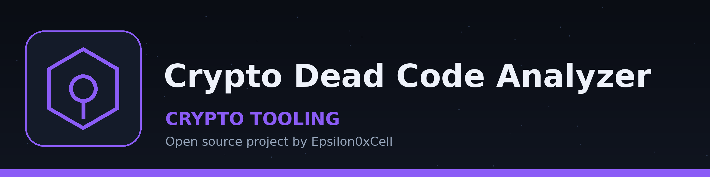

# crypto-dead-code-analyzer
Analyzes smart contract and Python source text for potential dead code with a text level scan: it reports functions defined but never called or referenced elsewhere in the file, alongside single mention checks for two Python library calls. The scan counts name references only and does not parse reachability beyond name references. - Focused on Basic cryptographic operations

## Install
`git clone https://github.com/ShadowGuardAI/crypto-dead-code-analyzer`

## Usage
`./crypto-dead-code-analyzer [params]`

## Parameters
- `-h`: Show help message and exit
- `-v`: Enable verbose logging.
- `-s`: Simulate potential vulnerabilities.

## License
Copyright (c) ShadowGuardAI
